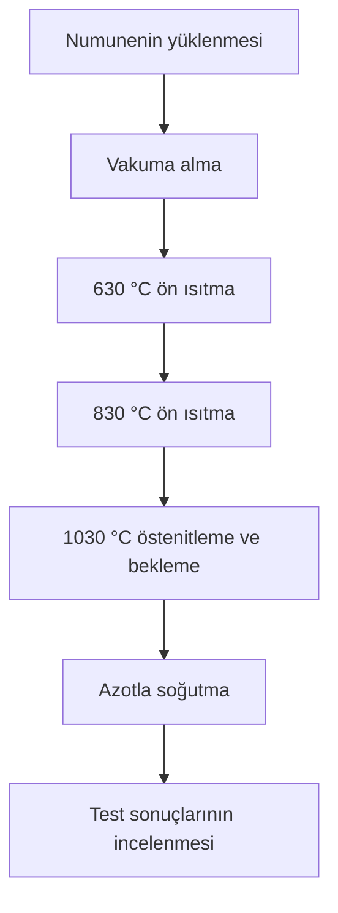

# VF-1D-A-696 Vakum Sertleştirme Fırını

## Genel tanıtım

VF-1D-A-696, Sistem Teknik Sanayi Fırınları A.Ş. tarafından üretilen, vakum altında ısıl işlem ve basınçlı gazla soğutma uygulamalarında kullanılan bir endüstriyel fırındır. Üreticinin yayımladığı NADCA çalışmasında H13 sıcak iş takım çeliği üzerindeki performansı incelenmiştir. [K1, K4](Kaynaklar.md)

Bu projede makine; proses kontrolü, siber güvenlik ve fiziksel emniyet ilişkisini değerlendirmek için seçilmiştir.

## Belgelenen sistem bileşenleri

| Bileşen / sistem | Testteki görevi | Kaynak |
|---|---|---|
| Isıtma rezistansları | Yükün belirlenen sıcaklıklara ısıtılması | K1, PDF s. 6 |
| Vakum sistemi | Isıtma süreci için vakum ve kısmi basınç koşullarının oluşturulması | K1, PDF s. 6 |
| Azotla soğutma ve fan | Isıl işlem sonrasında yükün soğutulması | K1, PDF s. 5–6 |
| Test termokuplları | Numunenin yüzey ve çekirdek sıcaklıklarının ölçülmesi | K1, PDF s. 6 |
| SCADA | Sıcaklık ve basınç değerlerinin izlenmesi ve kaydedilmesi | K1, PDF s. 6 |
| Enerji ölçümü | Toplam elektrik tüketiminin belirlenmesi | K1, PDF s. 7 |

Test termokuplları, kalıcı emniyet sensörleri olarak değerlendirilmemiştir. PLC modeli ve emniyet devresi yapısı mevcut kaynaklarda doğrulanmamıştır.

## Çalışma süreci

Aşağıdaki akış, yayımlanan NADCA testini özetler. [K1, PDF s. 4–7; K4](Kaynaklar.md)

Sıcaklık ölçümleri, test reçetesindeki bekleme adımlarının yönetiminde kullanılır. Soğutma aşamasında azot ve fan aracılığıyla ısı uzaklaştırılır; SCADA kayıtları üzerinden proses değerlendirilir. Bu akış işletme talimatı değildir.

## Safety 4.0 açısından inceleme konuları

Aşağıdaki başlıklar, belgelenen proses üzerinden belirlenen proje inceleme alanlarıdır; makinede tespit edilmiş açıklar değildir.

- Sıcaklık ve basınç ölçümlerinin güvenilirliği.
- Proses reçetelerinin yetkisiz değişikliklere karşı korunması.
- Kontrol ve emniyet fonksiyonları arasındaki bağımlılıklar.
- Yüksek sıcaklık, basınçlı gaz ve sıcak yükle ilişkili fiziksel tehlikeler.
- Varsa uzaktan bakım erişiminin kontrollü yönetimi.

[Kaynaklı teknik bilgiler](Teknik-Ozellikler/Teknik-Ozellikler.md) · [Kaynak envanteri](Kaynaklar.md)
