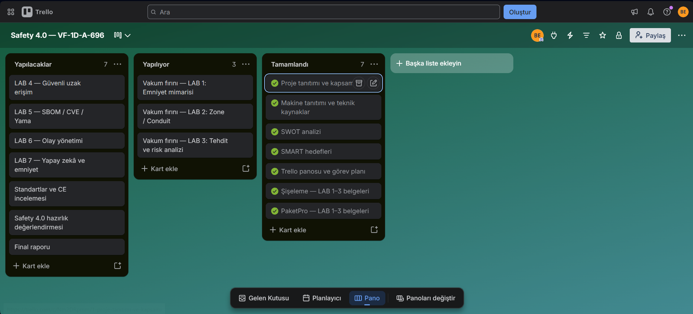

# Trello

Projenin haftalık görevleri Trello panosunda takip edilir. Kartlar Yapılacaklar, Yapılıyor ve Tamamlandı listelerinde düzenlenir; tamamlanan çalışmaların belgeleri GitHub’da tutulur.

[Safety 4.0 — VF-1D-A-696 Trello panosu](https://trello.com/b/ipfeQnJr/safety-40-vf-1d-a-696)

Güncel görev ve ilerleme durumu için pano esas alınır.

Pano görünümü; güncel durum için yukarıdaki bağlantıyı kullanabilirsiniz.
